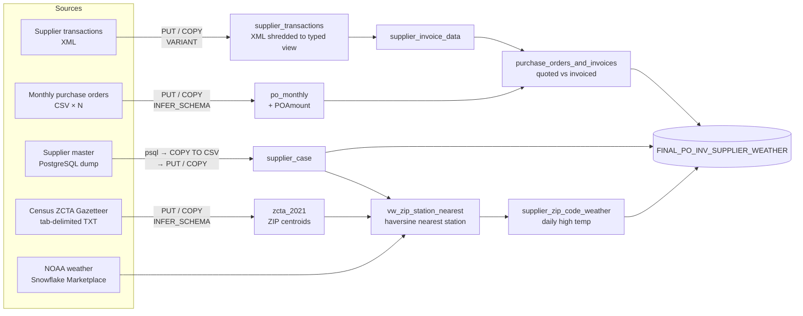

# Purchase Order × Weather ETL Pipeline

**An end-to-end ETL pipeline in Python and Snowflake that combines purchase orders, supplier invoices, supplier locations and daily weather from five sources in four formats into one analytical table.**

The question it sets up: *do invoiced amounts drift from quoted PO amounts, and does weather at the supplier's location on the transaction date tell us anything about it?*

---

## Architecture



## What each stage does

| Step | Source → target | Techniques |
|------|-----------------|------------|
| `xml` | XML → `supplier_transactions_raw` (VARIANT) → `supplier_transactions` | XML file format, `XMLGET` + `LATERAL FLATTEN` to shred nodes, `TRY_TO_*` safe casting |
| `zcta` | Census TXT → `zcta_2021` | Tab-delimited parsing, `INFER_SCHEMA` + `USING TEMPLATE` table creation |
| `purchase_orders` | Monthly CSVs → `po_monthly` | Bulk `PUT` of a whole folder, schema inference across many files, derived `POAmount` column |
| `invoices` | → `supplier_invoice_data`, `purchase_orders_and_invoices` | Typed persistence, PO-level aggregation, quoted-vs-invoiced variance |
| `suppliers` | PostgreSQL → CSV → `supplier_case` | `psql` restore, `COPY ... TO STDOUT` export with psycopg2, cross-database load |
| `weather` | Marketplace → `supplier_zip_code_weather` | ZIP+4 → 5-digit normalization with regex, haversine distance, `QUALIFY ROW_NUMBER()` to pick the nearest station |
| `final` | → `FINAL_PO_INV_SUPPLIER_WEATHER` | Joins the PO/invoice variance to the supplier's daily high temperature on the transaction date |

### Output: `FINAL_PO_INV_SUPPLIER_WEATHER`

| Column | Description |
|--------|-------------|
| `purchase_order_id` | Purchase order |
| `supplier_id` | Supplier |
| `zip_code` | Supplier's 5-digit ZIP |
| `wx_date` | Transaction date (= weather date) |
| `po_total_amount` | Quoted amount: Σ received outers × expected unit price |
| `amount_excluding_tax` | Amount the supplier invoiced |
| `invoiced_vs_quoted` | `po_total_amount − amount_excluding_tax` |
| `high_temp` | Daily high at the nearest NOAA station |

## Repository structure

```
├── etl_pipeline.py      # orchestrator: extract + load steps, runs the SQL below
├── sql/                 # transformation layer, one file per stage
│   ├── 01_supplier_transactions_view.sql
│   ├── 02_zcta_2021_view.sql
│   ├── 03_po_amount.sql
│   ├── 04_supplier_invoice_data.sql
│   ├── 05_purchase_orders_and_invoices.sql
│   ├── 06_supplier_weather.sql
│   └── 07_final_po_inv_supplier_weather.sql
├── data/README.md       # which input files go where
├── .env.example         # connection settings template
└── requirements.txt
```

## Running it

**Prerequisites:** a Snowflake account subscribed to the NOAA weather Marketplace listing, a PostgreSQL instance with `psql` on your PATH, and Python 3.9+.

```bash
pip install -r requirements.txt
cp .env.example .env          # fill in your Snowflake + Postgres credentials
# put the input files in data/ (see data/README.md)

python etl_pipeline.py                      # run the whole pipeline
python etl_pipeline.py --list               # list the steps
python etl_pipeline.py --steps weather final  # rerun only some steps
```

Each step is idempotent (`CREATE OR REPLACE` throughout), so you can rerun any step on its own.

## Tech stack

Python · Snowflake (stages, `COPY INTO`, `INFER_SCHEMA`, semi-structured XML, Marketplace data) · PostgreSQL · psycopg2 · SQL
